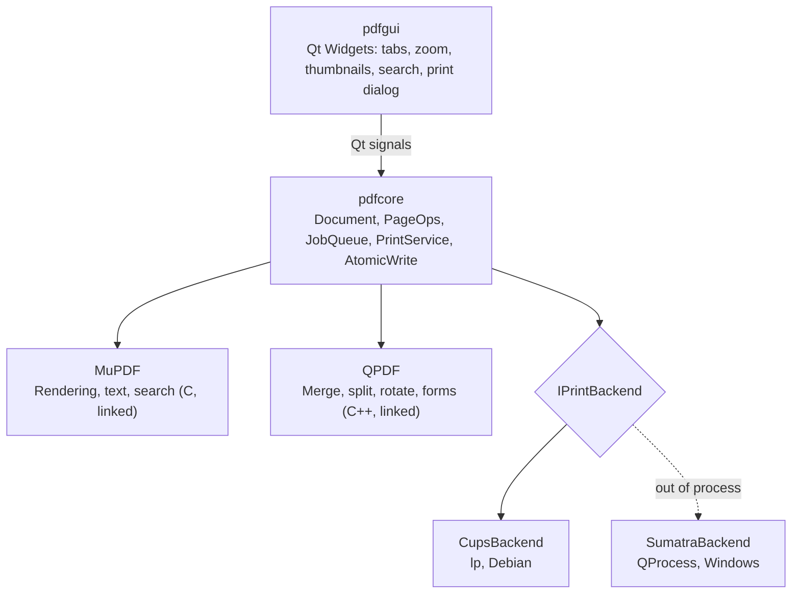
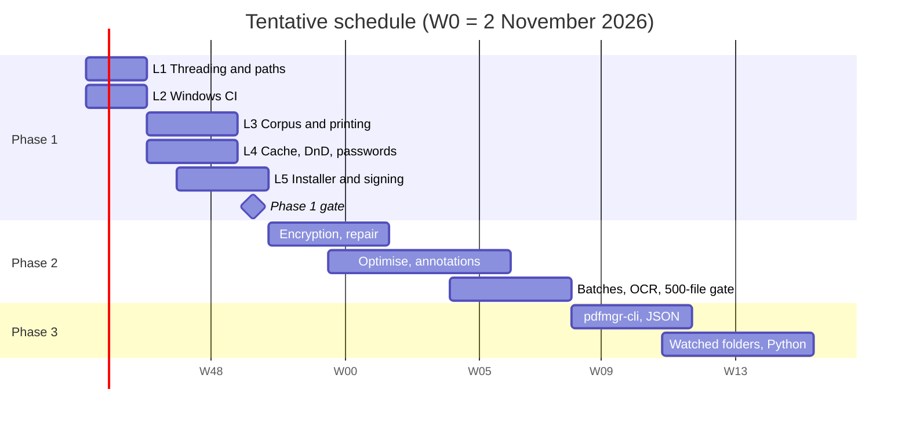

# Architecture and development planning dossier

Target architecture of the Qt 6 / C++20 PDF manager, actual state of the MVP (updated for PR `fix/review-round-1`, October 2026), known technical debt, and the plan for the remaining work packages through phases 2 and 3.

## Contents

1. [Context and goals](#context-and-goals)
2. [Architecture](#architecture)
3. [Stack and cross-platform build](#stack-and-cross-platform-build)
4. [Current MVP status](#current-mvp-status)
5. [Technical debt and known TODOs](#technical-debt-and-known-todos)
6. [Planning](#planning)
7. [Tentative schedule](#tentative-schedule)
8. [Risks and decisions](#risks-and-decisions)
9. [Licensing](#licensing)
10. [Next steps](#next-steps)

## Context and goals

A native Windows PDF management application, developed and integrated on Debian. Each engine has exactly one responsibility: MuPDF renders and reads, QPDF rewrites structure, SumatraPDF prints. Shipped as a single installer, with no Docker and no Java.

| Property | Value |
|---|---|
| Scope | Viewing, printing, page operations, structural validation, encryption, optimisation |
| Constraint | No runtime outside the application: DLLs plus a bundled `SumatraPDF.exe` |
| Rule | No feature implemented twice |
| Target | Windows x64 (MSVC); Debian for development |

## Architecture

| Topic | Design |
|---|---|
| Layers | The UI never touches an engine directly; everything goes through `pdfcore`. |
| Threading | `JobQueue` + Qt signals; a base `fz_context` with locks and `fz_clone_context` per worker; one `QPDF` instance per write job. Every job carries an owner (tab) id so a tab can cancel and wait for *its own* jobs only. |
| Cancellation | A generation counter discards stale tiles; each render gets a `CancelToken` wrapping one `fz_cookie`, which `bumpGeneration()` / `cancelOwner()` abort directly (no polling threads). |
| Thumbnails | Rendered lazily for the visible range of the list (plus a small margin), in batches of 8 pages, with at most 3 batches outstanding per tab. After a page operation only the affected pages are regenerated when the page count is unchanged. |
| Tab identity | Results are routed by a monotonic tab id (`JobQueue::newOwnerId()`), never by a pointer value. |
| Printing | `PrintService` depends only on `IPrintBackend`; arguments as a `QStringList`, timeout, one process per job. Temp-file deletion retries and is deferred if Windows still holds a lock. |
| File safety | Writes go to a temp file followed by an atomic replace (`QSaveFile`). Replacing a tab's working copy moves the old file to a backup first, restores it on failure, and closes all MuPDF/QPDF handles before renaming (Windows cannot rename open files). |
| Unicode paths | QPDF input is opened with `_wfopen` on Windows and passed through `QPDF::processInputSource`; output goes through `QSaveFile` (wide Win32 APIs). |
| Sumatra licence | Separate process, which isolates its GPL licence. |

## Stack and cross-platform build

| Component | Choice |
|---|---|
| Language / GUI | C++20, Qt 6 Widgets (6.4 or newer) |
| Build | CMake + Ninja, Debug and Release presets |
| Debian dev | apt packages listed in the README (Qt 6, MuPDF and its static-link dependencies, qpdf 11.9+, Catch2) |
| Windows | MSVC x64, vcpkg manifest (`vcpkg.json`, ports `libmupdf`, `qpdf`, `catch2`), GitHub Actions `windows-latest` |
| Tests | Catch2 + reference PDF corpus; Wine for quick checks; no qpdf executable needed (the QPDF library is used for `--check`) |
| Deployment | `windeployqt` + WiX (MSI) or Inno Setup, signed binaries |

Chosen option: Windows CI (option A). MinGW cross-compilation (option B) remains possible but requires rebuilding Qt, MuPDF and QPDF. Code is portable, with Win32-specific code isolated behind `#ifdef Q_OS_WIN`. Final print validation requires real Windows.

## Current MVP status

| Area | Status | Details |
|---|---|---|
| Debian build | ✅ Done | Debug and Release build and all tests pass. Verified on Debian 13 (Qt 6.8, qpdf 12.2, MuPDF 1.25). Ubuntu 24.04 (Qt 6.4, qpdf 11.9, static MuPDF 1.23) is covered by the `ubuntu` CI job. Whether a build is warning-free depends on the qpdf version; `POINTERHOLDER_TRANSITION=4` is now defined to silence the qpdf 11 warning. |
| MuPDF rendering | ✅ Done | Multithreaded, zoom, lazy batched thumbnails, `fz_cookie` cancellation |
| QPDF page operations | ✅ Done | Merge (keeps AcroForm fields and outlines), split, extract, reorder, rotate, atomic writes |
| IPrintBackend | ✅ Done | CUPS and Sumatra backends, print dialog |
| UI | 🟡 Partial | Tabs, search, Pages menu; page operations and search run on the JobQueue (PR #2) |
| Windows Unicode paths | ✅ Done (CI only) | `_wfopen` + `processInputSource`; tested with non-ASCII paths on Linux and in Windows CI |
| Windows CI | 🟡 See PR | Real vcpkg baseline, `libmupdf` port, pinned Sumatra 3.6.1 with SHA-256; status in the PR |
| Test corpus | 🟡 Partial | 8 generated files (including a form PDF) out of 50 planned |
| Real printing | 🔴 Remaining | Neither Windows nor CUPS printing tested on hardware |
| Windows file locking | 🔴 Remaining | Code handles it (close handles, retry, backup); not yet exercised on a real Windows desktop |
| Tile cache, drag-and-drop, password-protected PDFs | 🔴 Remaining | Not started |
| MSI installer and signing | 🔴 Remaining | TODO in the workflow |

## Technical debt and known TODOs

| Item | Location | Impact | Fix | Status |
|---|---|---|---|---|
| Working file deleted before rename | `DocumentTab::applyWorkingCopy` | Data loss if the rename failed | Validate result, backup + replace, restore on failure | ✅ Fixed (PR #1) |
| `waitForDone()` on the shared pool | `DocumentTab::applyWorkingCopy` | UI waited for every tab's jobs | Per-owner cancel + wait | ✅ Fixed (PR #1) |
| Two 5 ms polling threads per render | `JobQueue.cpp`, `Document.cpp` | One extra thread per render, wakeups | Single `fz_cookie` per render via `CancelToken` | ✅ Fixed (PR #1) |
| One thumbnail job per page, all resubmitted | `DocumentTab` | 2,000 jobs per rotate on a 2,000-page file | Visible-range batches, capped queue, affected pages only | ✅ Fixed (PR #1) |
| `quintptr(this)` tab identity | `DocumentTab` | Results could reach a new tab at a reused address | Monotonic tab id | ✅ Fixed (PR #1) |
| Merge dropped forms and bookmarks | `PageOps::merge` | Lost form fields and outlines | `QPDFAcroFormDocumentHelper::fixCopiedAnnotations`, outline copy with page remapping | ✅ Fixed (PR #1) |
| `toLocal8Bit` paths | `PageOps.cpp` | Failure on accented paths on Windows | `_wfopen` + `processInputSource` | ✅ Fixed (PR #1) |
| Tests required the qpdf CLI | `tests/` | Windows CI configure failure | QPDF library (`QPDFJob`) for checks and fixtures | ✅ Fixed (PR #1) |
| Test discovery needed a display | `tests/CMakeLists.txt` | Build aborted without a display | `DISCOVERY_MODE PRE_TEST`, offscreen by default | ✅ Fixed (PR #1) |
| Synchronous page operations | `MainWindow::runOp` | UI freeze on large files | `MainWindow::runTask`: `JobQueue` job owned by the tab, busy state disables conflicting actions, progress bar + Cancel (Esc) | ✅ Fixed (PR #2) |
| Synchronous search | `DocumentTab::find` | Freeze on large documents | `JobQueue` job with `CancelToken` and page progress (results delivered at the end, not incrementally) | ✅ Fixed (PR #2) |
| Split held every output in memory | `PageOps::split` | Memory spike on large files | Each chunk streamed to disk (temp + atomic rename) as soon as it is built; progress/cancel; partial outputs removed on cancel | ✅ Fixed (PR #2) |
| No real print test | `tests/` | Printing untested end to end | `print_to_pdf` ctest (label `print`): CUPS-PDF on Ubuntu CI, Microsoft Print to PDF on a file port via SumatraPDF on Windows CI | ✅ Added (PR #2) |
| Sumatra `landscape` setting shrank landscape pages onto portrait paper | `SumatraBackend` | Wrong orientation on Windows (found by `print_to_pdf`) | Landscape uses Sumatra's auto-rotation; Portrait adds `disable-auto-rotation`. Recheck on physical printers | ✅ Fixed (PR #2) |
| Non-split QPDF ops cannot be interrupted mid-way | `PageOps` | Cancel of a long merge/rotate waits for the QPDF write to finish (result then discarded) | Progress/cancel hooks inside QPDF writes | Open |
| No licence file | repository | Unclear terms | AGPLv3 `LICENSE` + `licenses/` third-party texts | ✅ Fixed (PR #2) |
| No tile cache | pdfcore | Re-render on every scroll | LRU cache per zoom level | Open |
| No installer or signing | `.github/workflows/windows.yml` | No deliverable | WiX or Inno Setup, code-signing certificate | Open |
| Corpus 8/50 | tests | Phase 1 gate not measurable | Complete with 50 varied files | Open |
| Physical printing untested | PrintService | Duplex, tray and colour only checkable on real printers | One pass on two physical printers | Open |
| Password-protected PDFs unsupported | Document | Cannot open | Password prompt, `fz_authenticate_password` | Open |

## Planning

> **Estimates are rough, unsubstantiated guesses.** The figures below (person-days for one developer) were not derived from any measurement, comparable project or task breakdown. Treat them as placeholders to be replaced once the first work packages have been timed.

| Package | Tasks | Depends on | Rough guess | Acceptance criterion |
|---|---|---|---|---|
| L1 Threading and paths | Operations and search in `JobQueue` (centralised cancellation and wide paths are done) | — | ~3 d | No UI freeze; accented-path tests green |
| L2 Windows CI | First green build, then packaging (`windeployqt`, Sumatra) | — | ~1–3 d | Build and tests green on `windows-latest` |
| L3 Corpus and printing | 50-file corpus, CUPS then Windows print tests, Windows file-locking tests | L1, L2 | ~5 d | Correct output on two physical printers |
| L4 Cache, DnD, passwords | Tile cache, thumbnail drag-and-drop, protected PDFs | L1 | ~6 d | Smooth scrolling; encrypted PDFs open |
| L5 Installer and signing | MSI via WiX, signing | L2 | ~4 d | Signed MSI installs on a clean Windows |
| Phase 1 gate | Validation campaign | L3, L4, L5 | ~2 d | 100% of the 50-file corpus opens without a crash; valid QPDF outputs; correct prints |
| Phase 2 | Encryption, repair, linearisation, optimisation, annotations and forms, optional OCR, batches | Gate 1 | ~45 d (guess) | 500-file batch without intervention, per-file error report |
| Phase 3 | `pdfmgr-cli`, JSON jobs, watched folders, Python access | Phase 2 | ~35 d (guess) | Same CLI and GUI results on the corpus |

## Tentative schedule

Weeks from Monday 2 November 2026. Durations follow the rough guesses above and are not commitments.

## Risks and decisions

| Risk | Likelihood | Mitigation |
|---|---|---|
| Printing differences between CUPS, Wine and Windows | High | Validation on real Windows with two printers |
| Windows file locking (viewer, antivirus, spooler holding files) | Medium | Close handles before replace, retries, backup/restore, deferred temp deletion; test on real Windows |
| vcpkg `libmupdf` port differences (static only on Windows, feature set) | Medium | Port pinned through the vcpkg baseline; custom overlay port if needed |
| MuPDF AGPL licence | Resolved | Project released under AGPLv3 (decided 24 Oct 2026); see Licensing |
| Sumatra flags changing between versions | Low | Pinned version and verified hash |

| Decision | Details | Status |
|---|---|---|
| Windows CI rather than cross-compilation | Same toolchain as the target | ✅ Decided |
| `QSaveFile` rather than `ReplaceFileW` | Atomic on both systems | ✅ Decided |
| MuPDF licence | AGPLv3 open source rather than an Artifex commercial licence | ✅ Decided (24 Oct 2026) |
| WiX or Inno Setup installer | To be decided in L5 | 🟡 Open |

## Licensing

**Decision (24 Oct 2026): PDF Manager is licensed under AGPLv3** ([`LICENSE`](../LICENSE)). The application links MuPDF, which is AGPLv3 unless an Artifex commercial licence is bought; the open-source route was chosen. Consequences:

- Every binary release must come with (or point to) the complete corresponding source, including build scripts. The public repository satisfies this as long as each release is tagged.
- Network use counts as distribution under AGPL section 13: a hosted version would have to offer its source to users.
- Changing to a commercial MuPDF licence later stays possible, but needs every contributor's code to be relicensable (consider a CLA before accepting outside contributions).

Third-party components ([`licenses/`](../licenses/README.md)):

| Component | Licence | How it is used |
|---|---|---|
| MuPDF | AGPL-3.0 | Linked |
| QPDF | Apache-2.0 (+ NOTICE) | Linked |
| Qt 6 | LGPL-3.0 | Dynamically linked, unmodified |
| SumatraPDF 3.6.1 | GPL-3.0 | Separate process; source link and written offer in `licenses/README.md` |
| Tesseract | Apache-2.0 | Planned (OCR), not shipped yet |

The installer (L5) must ship `LICENSE` and the `licenses/` folder.

## Next steps

1. Merge PR #2 (async operations, streaming split, print-to-PDF tests, licensing).
2. Test file locking on a real Windows PC (Explorer preview pane, antivirus).
3. One physical-printer pass for duplex, tray and colour (L3).
4. Installer: choose WiX or Inno Setup and order a code-signing certificate early.
5. Collect the 42 missing corpus files and book two test printers.
