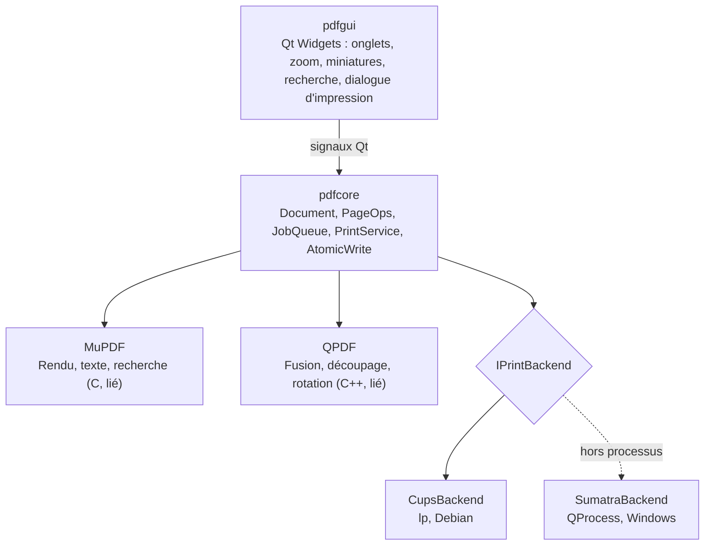
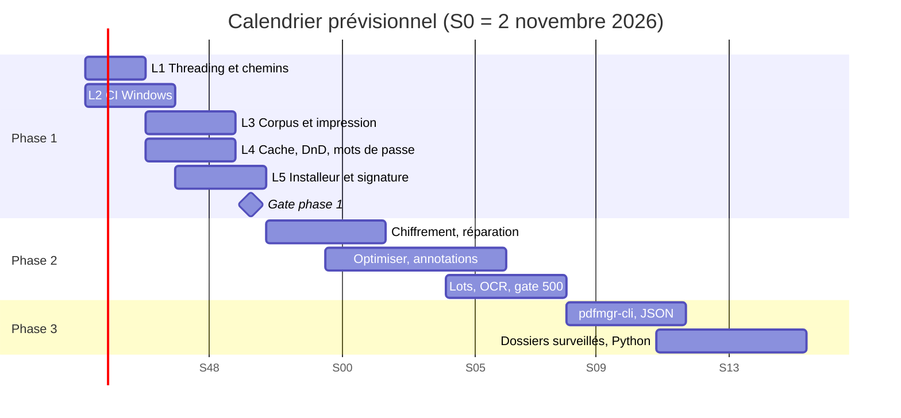

# Dossier d'architecture et de planification des développements

Architecture cible du gestionnaire PDF Qt 6 / C++20, état réel du MVP au 24 octobre 2026, dette connue et plan des lots restants jusqu'aux phases 2 et 3.

## Sommaire

1. [Contexte et objectifs](#contexte-et-objectifs)
2. [Architecture](#architecture)
3. [Stack et build cross-platform](#stack-et-build-cross-platform)
4. [État actuel du MVP](#état-actuel-du-mvp)
5. [Dette technique et TODOs connus](#dette-technique-et-todos-connus)
6. [Planification](#planification)
7. [Calendrier prévisionnel](#calendrier-prévisionnel)
8. [Risques et décisions](#risques-et-décisions)
9. [Licences](#licences)
10. [Prochaines étapes](#prochaines-étapes)

## Contexte et objectifs

Application native Windows de gestion PDF, développée et intégrée sous Debian. Chaque moteur a une seule responsabilité : MuPDF rend et lit, QPDF réécrit la structure, SumatraPDF imprime. Livraison dans un seul installeur, sans Docker ni Java.

| Propriété | Valeur |
|---|---|
| Périmètre | Visualisation, impression, opérations de pages, validation structurelle, chiffrement, optimisation |
| Contrainte | Aucun runtime hors application, DLL et `SumatraPDF.exe` embarqué |
| Règle | Aucune fonctionnalité implémentée deux fois |
| Cible | Windows x64 (MSVC) ; Debian pour le développement |

## Architecture

| Sujet | Conception |
|---|---|
| Couches | L'interface ne touche jamais un moteur ; tout passe par `pdfcore`. |
| Threading | `JobQueue` + signaux Qt ; `fz_context` de base avec verrous, `fz_clone_context` par worker ; une instance `QPDF` par job d'écriture. |
| Annulation | Compteur de génération pour les tuiles périmées, `fz_cookie` pour interrompre un rendu. |
| Impression | `PrintService` ne dépend que de `IPrintBackend` ; arguments en `QStringList`, timeout, file d'attente un processus par job. |
| Sécurité fichiers | Écriture dans un fichier temporaire puis remplacement atomique via `QSaveFile` ; l'original n'est jamais écrasé en cours d'écriture. |
| Licence Sumatra | Processus séparé, ce qui isole sa licence GPL. |

## Stack et build cross-platform

| Composant | Choix |
|---|---|
| Langage / GUI | C++20, Qt 6 Widgets LTS |
| Build | CMake + Ninja, presets Debug et Release |
| Dev Debian | paquets apt `qt6-base-dev`, `libmupdf-dev`, `libqpdf-dev`, `catch2`, `cups-client` |
| Windows | MSVC x64, vcpkg manifest (`vcpkg.json`), GitHub Actions `windows-latest` |
| Tests | Catch2 + corpus de PDF de référence ; Wine pour les tests rapides |
| Déploiement | `windeployqt` + WiX (MSI) ou Inno Setup, binaires signés |

Option retenue : CI Windows (option A). La cross-compilation MinGW (option B) reste possible mais impose de recompiler Qt, MuPDF et QPDF. Code portable, Win32 isolé derrière `#ifdef Q_OS_WIN`. La validation finale d'impression exige un vrai Windows.

## État actuel du MVP

| Domaine | État | Détail |
|---|---|---|
| Build Debian | ✅ Fait | Debug et Release sans avertissement, 24 tests Catch2 verts |
| Rendu MuPDF | ✅ Fait | Multi-thread, zoom, miniatures |
| Opérations de pages QPDF | ✅ Fait | Fusion, découpage, extraction, réorganisation, rotation, écriture atomique |
| IPrintBackend | ✅ Fait | Backends CUPS et Sumatra, dialogue d'impression |
| Interface | 🟡 Partiel | Onglets, recherche, menu Pages ; opérations et recherche sur le thread UI |
| Chemins Unicode Windows | 🟡 Partiel | `toLocal8Bit` dans `PageOps.cpp` |
| CI Windows | 🟡 Partiel | Workflow écrit, jamais exécuté |
| Corpus de test | 🟡 Partiel | 7 fichiers sur 50 |
| Impression réelle | 🔴 Reste | Ni Windows ni CUPS testés |
| Cache de tuiles, glisser-déposer, PDF protégés | 🔴 Reste | Non commencés |
| Installeur MSI et signature | 🔴 Reste | TODO dans `windows.yml` |

## Dette technique et TODOs connus

| Point | Emplacement | Impact | Correction |
|---|---|---|---|
| Opérations de pages synchrones | `MainWindow.cpp:108` | Gel de l'UI sur gros fichiers | Passer par `JobQueue` avec progression |
| Recherche synchrone | `DocumentTab.cpp:112` | Gel sur gros documents | Job asynchrone, résultats incrémentaux |
| Chemins `toLocal8Bit` | `PageOps.cpp:16` | Échec sur chemins accentués Windows | Chemin large ou `InputSource` QPDF |
| Thread de surveillance par rendu | `Document.cpp:69` | Un `std::thread` créé par rendu annulable | Annulation centralisée via `fz_cookie` partagé |
| Pas de cache de tuiles | pdfcore | Re-rendu à chaque défilement | Cache LRU par niveau de zoom |
| CI jamais exécutée | `windows.yml` | Aucun binaire Windows | Baseline vcpkg, hash Sumatra, cible MuPDF |
| Installeur et signature absents | `windows.yml:41` | Pas de livrable | WiX ou Inno Setup, certificat de signature |
| Corpus 7/50 | tests | Gate phase 1 non mesurable | Compléter à 50 fichiers variés |
| Impression réelle non testée | PrintService | Risque principal du MVP | Tests sur deux imprimantes physiques |
| PDF protégés non gérés | Document | Ouverture impossible | Saisie du mot de passe, `fz_authenticate_password` |

## Planification

> **Estimations** — Les efforts sont des estimations en jours-homme pour un développeur, à recaler après la première exécution de la CI.

| Lot | Tâches | Dépend de | Effort estimé | Critère de validation |
|---|---|---|---|---|
| L1 Threading et chemins | Ops et recherche dans `JobQueue`, chemins larges, annulation centralisée | — | 4 j | Aucun gel UI ; tests chemins accentués verts |
| L2 CI Windows | Baseline vcpkg, cible MuPDF, pin et hash Sumatra, premier build vert | — | 4 j | Build et tests verts sur `windows-latest` |
| L3 Corpus et impression | Corpus 50 fichiers, tests impression CUPS puis Windows | L1, L2 | 5 j | Impression correcte sur deux imprimantes physiques |
| L4 Cache, DnD, mots de passe | Cache de tuiles, glisser-déposer miniatures, PDF protégés | L1 | 6 j | Défilement fluide ; ouverture des PDF chiffrés |
| L5 Installeur et signature | `windeployqt`, MSI WiX, signature | L2 | 4 j | MSI signé installé sur Windows propre |
| Gate phase 1 | Campagne de validation | L3, L4, L5 | 2 j | 100 % du corpus de 50 ouverts sans crash ; sorties QPDF valides ; impressions correctes |
| Phase 2 | Chiffrement, réparation, linéarisation, optimisation, annotations et formulaires, OCR optionnel, lots | Gate 1 | 45 j | Lot de 500 fichiers sans intervention, rapport d'erreurs par fichier |
| Phase 3 | `pdfmgr-cli`, jobs JSON, dossiers surveillés, accès Python | Phase 2 | 35 j | Mêmes résultats CLI et GUI sur le corpus |

## Calendrier prévisionnel

Semaines à partir du lundi 2 novembre 2026 ; durées estimées.

## Risques et décisions

| Risque | Probabilité | Mitigation |
|---|---|---|
| Écarts d'impression entre CUPS, Wine et Windows | Élevée | Validation sur vrai Windows avec deux imprimantes |
| Paquets vcpkg MuPDF incomplets | Moyenne | Port personnalisé ou build MuPDF dédié en CI |
| Licence MuPDF AGPL | Moyenne | Décision avant toute distribution |
| Flags Sumatra variables selon version | Faible | Version épinglée et hash vérifié |

| Décision | Détail | Statut |
|---|---|---|
| CI Windows plutôt que cross-compilation | Même toolchain que la cible | ✅ Décidé |
| `QSaveFile` plutôt que `ReplaceFileW` | Atomique sur les deux systèmes | ✅ Décidé |
| Installeur WiX ou Inno Setup | À trancher dans L5 | 🟡 Ouvert |

## Licences

> ⚠️ **Question ouverte** — L'application est liée à MuPDF, donc sous AGPLv3 sauf licence commerciale Artifex. Il faut choisir avant la première distribution : publier le code source sous AGPL, ou acheter une licence commerciale.

QPDF est sous Apache 2.0, Qt 6 sous LGPL en liaison dynamique, SumatraPDF sous GPLv3 mais isolé dans un processus séparé.

## Prochaines étapes

1. Lancer L1 : sortir opérations et recherche du thread UI, corriger les chemins Windows.
2. En parallèle, faire tourner la CI Windows une première fois (L2).
3. Trancher la licence MuPDF.
4. Réunir les 43 fichiers manquants du corpus et réserver deux imprimantes de test.
